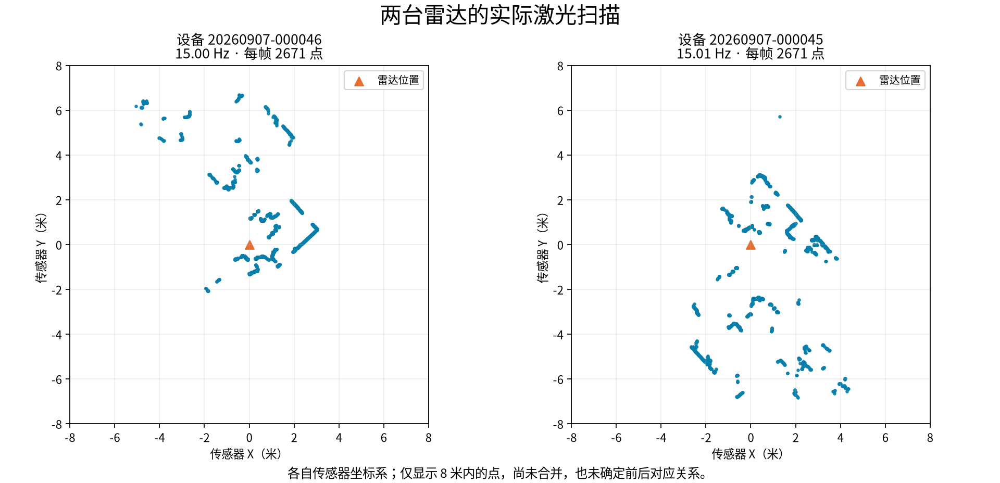
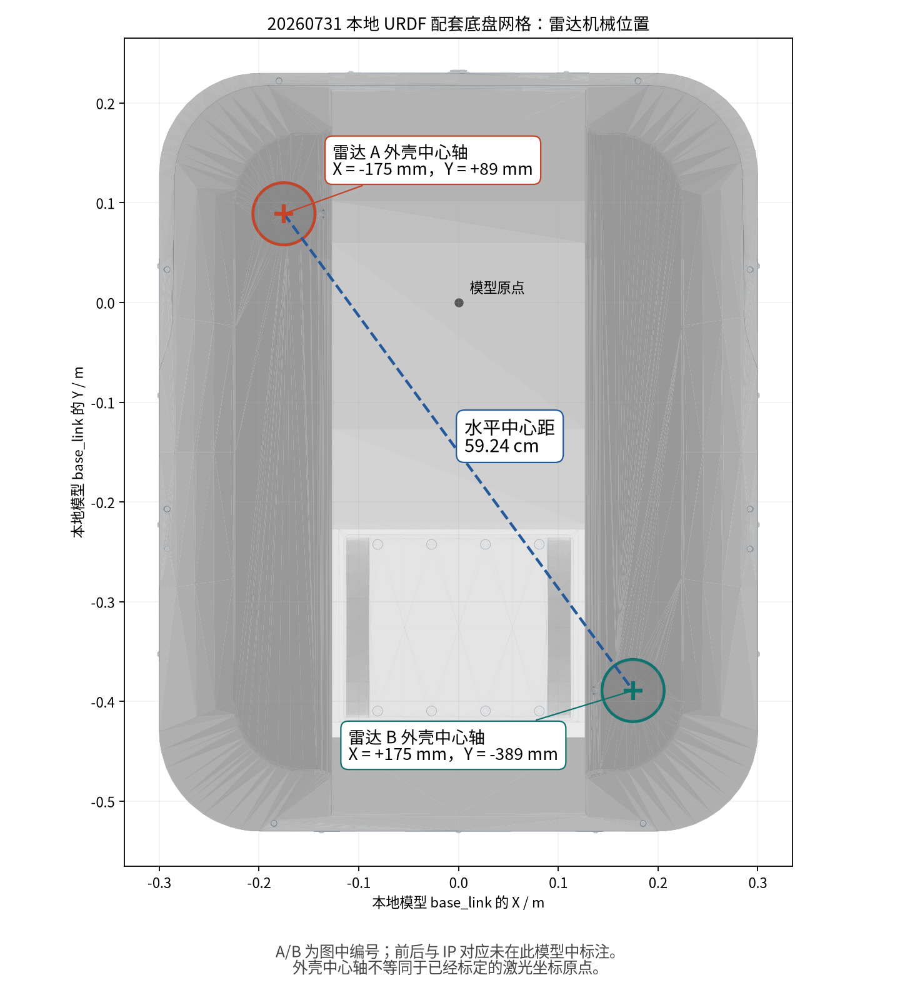
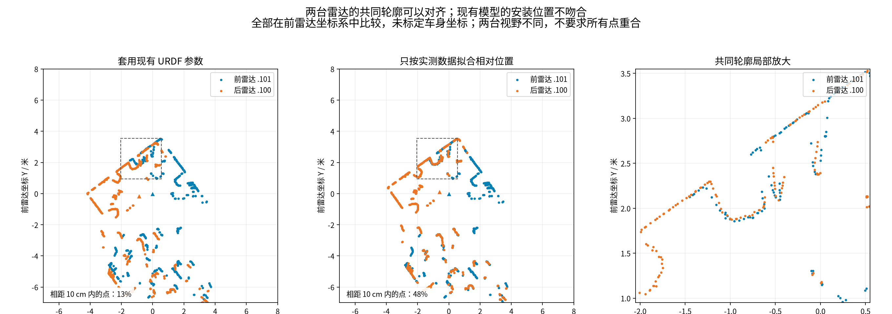

# 雷达与模型

## 实时显示

```bash
bash run.sh lidar
```

[雷达模块](../apps/lidar_viewer/) 通过底盘 `.58.3` 的 SSH/ROS 显示两路扫描，可调整显示半径与暂停画面。当前记录为科力 LS3-2027DE，前雷达 `.101`、后雷达 `.100`。各图使用自己的雷达坐标系。



[厂家 LS3 系列产品页](https://www.sdkeli.com/cpzx/jgld/825.html)，下图为厂家产品示意图：


## 模型和离线分析

[models/](../models/) 包含左右臂与整机运动学 URDF、底盘及手腕分析网格，校验值见 [manifest.json](../models/manifest.json)。ART7-R7 DH 长度为 187/290/310 mm，法兰相对腕心偏移 `[-106,0,0] mm`。

```bash
bash run.sh diagnostics geometry
bash run.sh diagnostics wrist
bash run.sh diagnostics lidar
```

底盘模型中的雷达外壳中心 XY 约为 A `[-175,+89] mm`、B `[+175,-389] mm`，水平距离约 59.24 cm。



内置 [扫描样例](../data/lidar/scans-sample.json.gz) 的相对配准中心距约 60.7 cm。对照模型曾出现约 88.6 cm 的不匹配参数，不直接用于当前底盘。



外壳中心不是最终扫描 TF；扫描原点高度、零射线方向和车身坐标关系仍需标定。相对配准不等于完整 SLAM 或自主导航。
