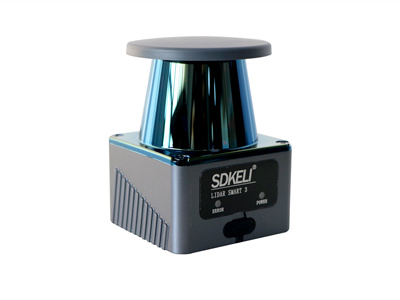

# 雷达与模型

## 实时显示

```bash
bash run.sh lidar
```

[雷达模块](../apps/lidar_viewer/) 通过底盘 `.58.3` 的 SSH/ROS 显示两路扫描，可调整显示半径与暂停画面。当前记录为科力 LS3-2027DE，前雷达 `.101`、后雷达 `.100`。各图使用自己的雷达坐标系。


[厂家 LS3 系列产品页](https://www.sdkeli.com/cpzx/jgld/825.html)，下图为厂家产品示意图：



## 已部署外参的历史记录（2026-10-19）

按用户指定的底盘中心坐标，导航 `base_link` 采用 X 向前、Y 向左、Z 向上。以下 XYZ 均相对运行中的 `base_link`，单位为米；roll、pitch 均为 0：

| 雷达 | 扫描坐标系 | XYZ / m | yaw |
|---|---|---|---|
| 前，`.101` | `front_laser_link` | `(0.239, 0.175, 0.1455)` | `+45°` |
| 后，`.100` | `back_laser_link` | `(-0.239, -0.175, 0.1455)` | `−135°` |

`base_footprint → base_link` 保持纯高度差 `(0, 0, 0.065)`，所以雷达原点相对 `base_footprint` 的 Z 为 `0.2105 m`。工作台实时雷达视图中的箭头表示车身 +X，对应 W 的前进命令方向。

机器人持久配置：
`/opt/fairino_AMR_project_B/AMR_SAFT/install/amr_8dof_description/share/amr_8dof_description/urdf/amr_8dof.urdf`。
实际启动器 `diffbot_aux.launch.py` 读取该文件，`/robot_state_publisher` 发布两个雷达固定 TF；`/laserscan_multi_merger` 将双雷达转换至 `base_link`，输出 `/scan` 和 `/merged_cloud`。

2026-10-19 的记录显示当时已备份并更新持久 URDF 和运行中的 `robot_description`，验证新监听器获得的 TF、扫描持续更新，以及合并点云 Z 为 `0.1455 m`。只改变两个雷达固定关节及其注释，没有重启驱动、使能或发送运动指令。应用时旧 SLAM 已退出，里程计保持暂停；后续应新建地图，不接着累积旧外参下的工作地图。这些检查确认当时软件应用了指定值，不等同于已完成实测标定或建图精度验证。

2026-10-22 从 `192.168.58.204` 同步了上述记录和本地 [运行模型](../models/amr_8dof.urdf)，未重新部署或检查机器人当前 TF。此次坐标修正将旧 CAD 平面坐标按 `x_new = -y_old - 0.150`、`y_new = x_old` 转换，雷达 yaw 同时加 90°。此前轮速与 SLAM 轨迹的约 88° 最佳拟合偏差仍需新地图和运动测试复核。

机器人备份目录：
`/home/fairino/.local/share/fairino-lidar-extrinsics/backups/20261019T070048Z/`。
修改前文件、修改后文件、执行与验证记录在来源电脑仓库的 `logs/lidar-extrinsics-20261019/`；本次本地快照位于 `logs/20261022-xense-map-review/remote-source/logs/lidar-extrinsics-20261019/`。
回退时需同时恢复备份 URDF 和运行中的 `robot_description`；只恢复磁盘文件不会立即更新 TF。

在机器人 ROS Domain 1 环境只读复查：

```bash
timeout 6s ros2 run tf2_ros tf2_echo base_link front_laser_link
timeout 6s ros2 run tf2_ros tf2_echo base_link back_laser_link
```

旧运行值为前 `(0.175, -0.389, 0), -45°`、后 `(-0.175, 0.089, 0), +135°`。下面保留的 CAD 外壳坐标属于历史模型分析，不能直接作为运行 `base_link` 的外参。

## 模型和离线分析

[models/](../models/) 包含左右臂与整机运动学 URDF、底盘及手腕分析网格，校验值见 [manifest.json](../models/manifest.json)。ART7-R7 DH 长度为 187/290/310 mm，法兰相对腕心偏移 `[-106,0,0] mm`。

```bash
bash run.sh diagnostics geometry
bash run.sh diagnostics wrist
bash run.sh diagnostics lidar
```

底盘模型中的雷达外壳中心 XY 约为 A `[-175,+89] mm`、B `[+175,-389] mm`，水平距离约 59.24 cm。


内置 [扫描样例](../data/lidar/scans-sample.json.gz) 的相对配准中心距约 60.7 cm。对照模型曾出现约 88.6 cm 的不匹配参数，不直接用于当前底盘。


外壳中心不是最终扫描 TF；扫描原点高度、零射线方向和车身坐标关系仍需标定。相对配准不等于完整 SLAM 或自主导航。
